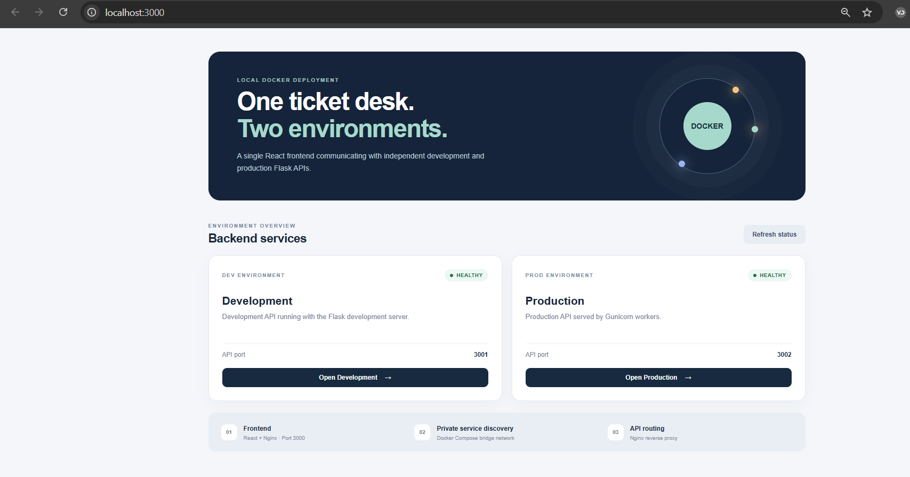
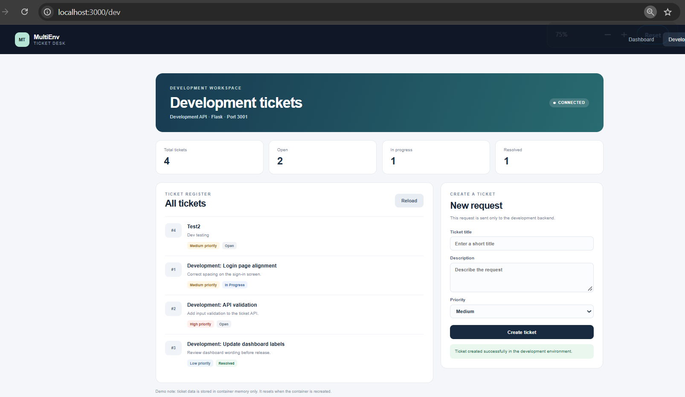
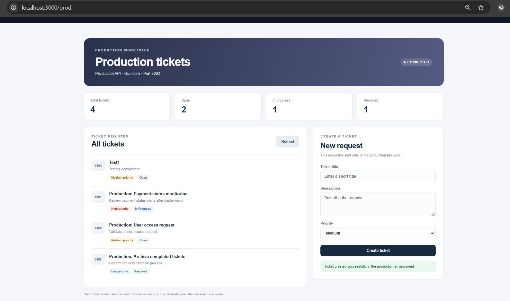
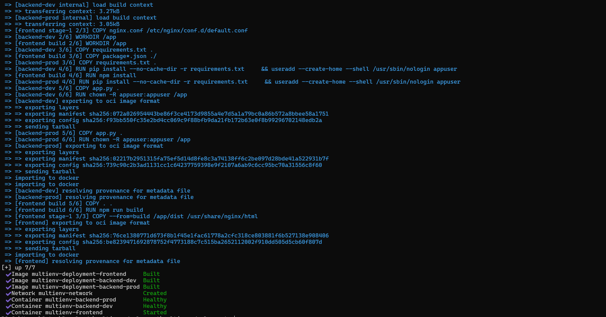
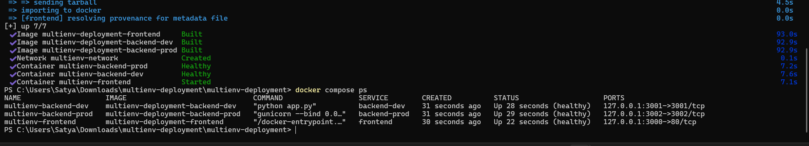
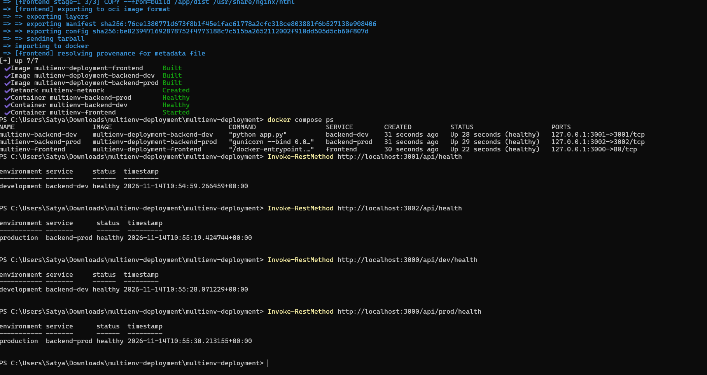
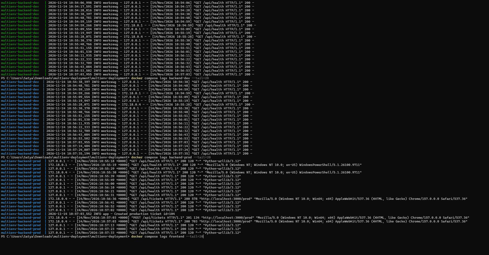
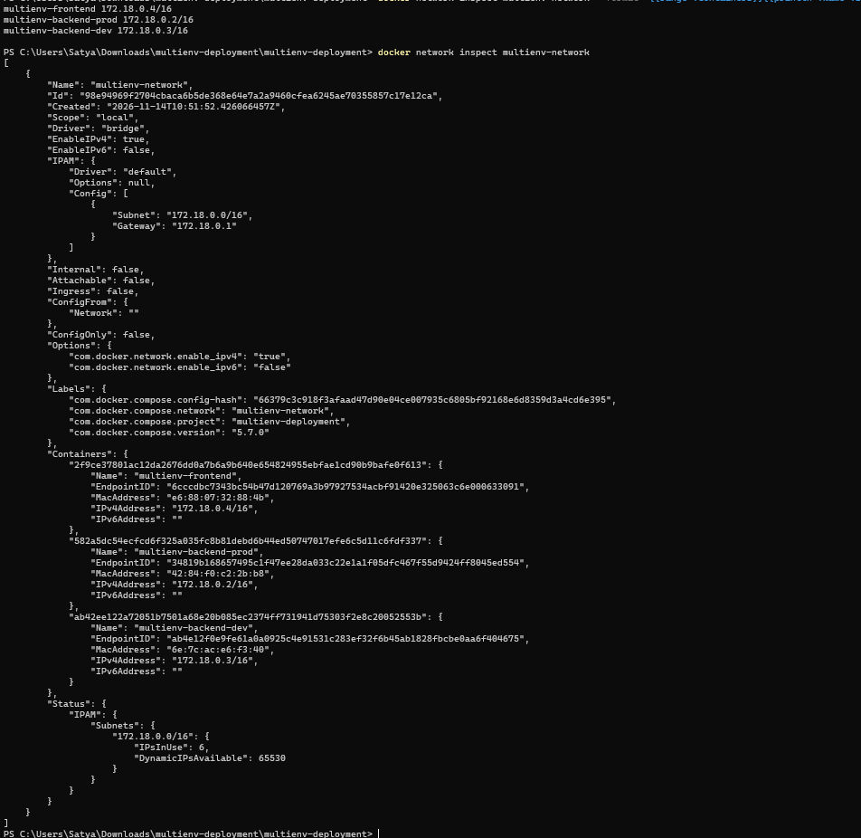

# MultiEnv Ticket Desk — Docker Deployment

A local three-container demonstration of a React frontend communicating with two independent Flask backends (development and production).

> **Important:** The assignment brief provided a folder structure but did not include the original ticket application's source code. This repository therefore contains a working sample ticket desk so the Docker deployment and service-to-service communication can be demonstrated. Replace the sample Flask/React code with the instructor's application code when it becomes available.


## Deployment status — verified on Windows (14 November 2026)

**Status: Working locally.** The screenshots below are from the actual Windows/Docker Desktop deployment, not mockups. Docker Desktop 4.99.0, Docker Engine 29.9.3 and Docker Compose v5.7.0 were shown in the terminal. All three images built, all three containers reported **healthy**, and both API health endpoints returned `healthy`. The React dashboard loaded at `/`, the two workspaces loaded at `/dev` and `/prod`, and test tickets were successfully created in both environments. The production backend logs recorded `POST /api/tickets` with HTTP **201 Created**.

**Repository:** https://github.com/Drstrange1919/Multienv-deployment

### Screenshot evidence — working application

**Frontend dashboard — both backend services healthy**



**Development workspace — test ticket `Test2` created (4 tickets)**



**Production workspace — test ticket `Test1` created (4 tickets)**



**Docker Compose — images built and three healthy containers**





**API health verification — both direct APIs and both Nginx-proxied routes**



**Service logs — successful requests and production ticket creation**



**Docker network inspection — three attached containers**



| Evidence | Observed result |
|---|---|
| `docker compose config` | Valid Compose configuration |
| `docker compose up -d --build` | Three images built, network created, services started |
| `docker compose ps` | Frontend, backend-dev, backend-prod all healthy |
| `GET /api/health` (3001, 3002) | Healthy development and production responses |
| `GET /api/dev/health`, `GET /api/prod/health` (3000) | Nginx routes both APIs successfully |
| `/dev` | Ticket `Test2` created, total increased to 4 |
| `/prod` | Ticket `Test1` created, total increased to 4 |
| Production backend logs | `POST /api/tickets` → HTTP 201 |
| `docker network inspect multienv-network` | Three containers connected to a bridge network |

The observed internal addresses were `172.18.0.4` (frontend), `172.18.0.3` (development), and `172.18.0.2` (production); these addresses are ephemeral and may change. The demo binds host ports to `127.0.0.1`, so its URLs are accessible on the deployment computer, not publicly from GitHub or the internet. Ticket data is **in memory** and may reset when a backend container is recreated. Screenshots document one successful test session, not a continuous availability guarantee.

## Architecture

```text
Browser: http://localhost:3000
              |
              v
       frontend (Nginx + React)
          /             \
         /               \
  /api/dev/*         /api/prod/*
       |                   |
       v                   v
 backend-dev          backend-prod
 Flask :3001          Gunicorn :3002
       \                   /
        +-- Docker bridge network --+
```

## Services and URLs

| Service | Host URL | Container port | Purpose |
|---|---|---:|---|
| Frontend | http://localhost:3000 | 80 | React dashboard and Nginx reverse proxy |
| Development page | http://localhost:3000/dev | — | React ticket screen connected to the development API |
| Production page | http://localhost:3000/prod | — | React ticket screen connected to the production API |
| Development API | http://localhost:3001/api/health | 3001 | Flask development server |
| Production API | http://localhost:3002/api/health | 3002 | Gunicorn production server |

All published ports are bound to `127.0.0.1`, so this local demo is not exposed to other computers on your network.

## Prerequisites

- Windows 10/11 supported by the current Docker Desktop release, with hardware virtualization enabled.
- Docker Desktop for Windows using the WSL 2 backend.
- At least 8 GB RAM is a practical minimum for Docker Desktop according to its Windows requirements.
- No host installation of Python, Node.js, Flask, Nginx, or a database is required. Docker builds the images and runs those components inside containers.

Install Docker Desktop using the official instructions: <https://docs.docker.com/desktop/setup/install/windows-install/>.

## Quick start (Windows PowerShell)

1. Start Docker Desktop and wait until it says the Docker Engine is running.
2. Open PowerShell in this repository's `multienv-deployment` folder (the folder containing `docker-compose.yml`).
3. Verify the Docker CLI and Compose plugin:

   ```powershell
   docker version
   docker compose version
   ```

4. Validate the Compose file:

   ```powershell
   docker compose config
   ```

5. Build images and start all services:

   ```powershell
   docker compose up -d --build
   ```

6. Check container state:

   ```powershell
   docker compose ps
   ```

   Wait until all three services show `Up` and preferably `healthy` in the STATUS column.

7. Open these pages:

   - Dashboard: <http://localhost:3000>
   - Development: <http://localhost:3000/dev>
   - Production: <http://localhost:3000/prod>

8. Stop the application when finished:

   ```powershell
   docker compose down
   ```

## Test API connectivity (PowerShell)

```powershell
Invoke-RestMethod http://localhost:3001/api/health
Invoke-RestMethod http://localhost:3002/api/health
Invoke-RestMethod http://localhost:3001/api/tickets
Invoke-RestMethod http://localhost:3002/api/tickets
```

The first health response should report `environment: development`; the second should report `environment: production`.

The frontend also routes requests through Nginx on port 3000:

```powershell
Invoke-RestMethod http://localhost:3000/api/dev/health
Invoke-RestMethod http://localhost:3000/api/prod/health
```

## Useful Docker commands

```powershell
# Show running containers

docker compose ps

# Follow logs from all three services

docker compose logs -f

# Follow one service's logs

docker compose logs -f backend-dev
docker compose logs -f backend-prod
docker compose logs -f frontend

# Rebuild after changing application code or a Dockerfile

docker compose up -d --build

# Stop and remove containers and the project network (images remain)

docker compose down

# Also remove this project's locally built images

docker compose down --rmi local
```

## Project layout

```text
multienv-deployment/
├── docker-compose.yml
├── README.md
├── backend/
│   ├── dev/
│   │   ├── app.py
│   │   ├── requirements.txt
│   │   ├── Dockerfile
│   │   └── .env
│   └── prod/
│       ├── app.py
│       ├── requirements.txt
│       ├── Dockerfile
│       └── .env
├── frontend/
│   ├── src/
│   ├── public/             # optional static assets folder for your own files
│   ├── Dockerfile
│   ├── nginx.conf
│   └── package.json
├── docs/
│   ├── DEPLOYMENT-GUIDE.md
│   └── VIVA-QA.md
├── evidence/
│   └── README.md
└── submission/
    └── submission-info.txt
```

## Configuration

- `backend/dev/.env` configures the development API (`APP_ENV=development`, `PORT=3001`).
- `backend/prod/.env` configures the production API (`APP_ENV=production`, `PORT=3002`).
- `docker-compose.yml` publishes the frontend on host port 3000, development API on 3001, and production API on 3002.
- The frontend uses relative API paths. Nginx sends `/api/dev/...` to `backend-dev` and `/api/prod/...` to `backend-prod` over the Compose network. The browser does not need to know Docker's internal service names.

## Troubleshooting

### `docker` is not recognized

Close and reopen PowerShell after installing Docker Desktop. Confirm Docker Desktop is installed and running, then run `docker version` again.

### Cannot connect to the Docker daemon / engine

Open Docker Desktop and wait for the Engine to start. If it remains unavailable, restart Docker Desktop. On Windows, check that the WSL 2 backend is enabled.

### A port is already allocated

Another program is using host port 3000, 3001, or 3002. Find the process with:

```powershell
netstat -ano | findstr :3000
netstat -ano | findstr :3001
netstat -ano | findstr :3002
```

Stop the conflicting application or change the host-side number before the colon in `docker-compose.yml`. Example: `127.0.0.1:3010:80` means browse to `http://localhost:3010` while the container still listens on port 80.

### Backend container is unhealthy

```powershell
docker compose logs backend-dev
docker compose logs backend-prod
docker compose ps
```

Check that the matching `.env` file and Dockerfile use the same port as the health check.

### Frontend loads but API data does not appear

```powershell
docker compose logs frontend
docker compose logs backend-dev
docker compose logs backend-prod
Invoke-RestMethod http://localhost:3000/api/dev/health
Invoke-RestMethod http://localhost:3000/api/prod/health
```

Check the Nginx `proxy_pass` targets and ensure all services are attached to `multienv-network` in Compose.

### Changes are not visible

Rebuild and recreate the services:

```powershell
docker compose down
docker compose up -d --build
```

If a dependency or cached build is the issue:

```powershell
docker compose build --no-cache
docker compose up -d
```

## Assumptions and limitations

1. This is a local educational deployment; no EC2 instance or AWS security group is required. Localhost-only port bindings are used.
2. The original ticket application's source files were not supplied, so the included ticket app is sample functionality that proves deployment and routing.
3. Tickets are stored in process memory, not a database. They disappear when a backend container is recreated.
4. Authentication, HTTPS, database persistence, secrets management, and production monitoring are outside this demo's scope.
5. The production backend uses Gunicorn; the development backend uses Flask's built-in development server.
6. If the instructor requires access from another computer, localhost-only port bindings and firewall rules would need to be deliberately changed. Do not expose this demo publicly without adding appropriate security controls.

## Submission checklist

- [x] `docker compose config` succeeds.
- [x] Three containers are running and healthy.
- [x] Dashboard opens on port 3000.
- [x] `/dev` lists development sample tickets.
- [x] `/prod` lists production sample tickets.
- [x] Both health endpoints return the correct environment name.
- [x] A test ticket can be created in each environment.
- [x] Screenshots are saved in `evidence/`.
- [ ] `submission/submission-info.txt` contains your name and public GitHub repository URL.

## Publish the submission to GitHub

1. Sign in to GitHub and create a **Public** repository named `multienv-deployment-[YourName]`. Do not initialize it with another README because this folder already contains one.
2. Install Git for Windows if it is not already installed, or use GitHub Desktop.
3. From PowerShell in the project root, run (replace the URL with your repository URL):

   ```powershell
   git init
   git add .
   git commit -m "Initial multi-environment Docker deployment"
   git branch -M main
   git remote add origin https://github.com/Drstrange1919/Multienv-deployment.git
   git push -u origin main
   ```

4. Open the public repository in a browser and confirm the README and project files are visible.
5. Edit `submission/submission-info.txt` with your full name, repository URL, actual deployment status, and submission date. Commit and push that update too.

Never commit real passwords, tokens, private keys, or production connection strings. The included `.env` files contain only non-secret demo settings.
